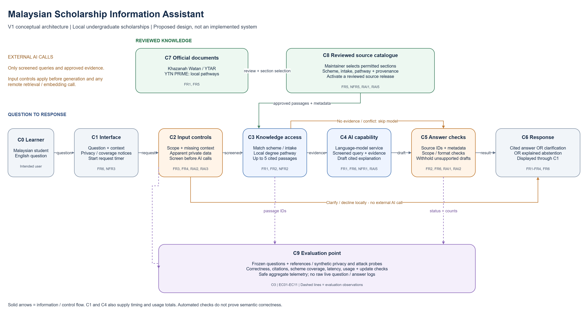

# V1 Architecture and Design Decisions

Malaysian Scholarship Information Assistant | Version 1.0 | 27 October 2026

This conceptual design follows the [requirements](week2_requirements.md) and [evaluation plan](week2_evaluation_criteria.md). Components describe functions, not selected products. No model, vector database, web framework or deployment service has been chosen, and no implementation or passing test results are claimed.

## Step C1 - Simplest Architecture and Its Limits

The starting point is **user -> application interface -> language-model capability -> response**. It supports a basic interaction but does not independently establish official source access, correct intake/pathway context, checkable citations, safe treatment of private text or evidence for evaluation. These missing capabilities justify the additions below. A static keyword-search interface is the non-generative baseline and remains a possible simplification if the AI version fails to improve useful evidence access.

## Step C2 - Requirements to Architecture Needs

| Requirement ID | What the requirement needs | Architecture response |
|---|---|---|
| FR1, FR5, NFR2, NFR5 | Access to approved and updateable local-undergraduate information | C7 official documents; C8 reviewed source catalogue; C3 context-aware knowledge access |
| FR2, RAI1 | Evidence passages and provenance carried into the answer | C3 returns passage IDs and metadata; C5 checks references before release |
| FR3, FR4, RAI2 | Clarification and refusal without guessing context | C2 scope/context control with a local path to C6 |
| RAI3 | Private text blocked before every external AI call | C2 privacy control; C9 stores safe aggregate measurements only |
| FR6, NFR1 | A readable explanation conditioned on selected evidence | C4 language-model capability; C5 answer validation and formatting |
| NFR3, NFR4 | A short interaction path and measured time/usage | C1 request timing; C3/C4 usage counters; C9 evaluation point |
| RAI4, RAI5 | Visibility of scheme coverage and testing of source/query attacks | C5 coverage notice; C8 source review; C2/C4 instruction boundary; C9 stratified/adversarial evaluation |

## Step C3 - V1 Components and Flows

| ID | Function | Inputs and outputs |
|---|---|---|
| C0 | Malaysian learner | Sends an English scholarship question and reads the result; no applicant records are required. |
| C1 | Application interface | Accepts a question and optional scheme/intake/pathway selection, shows privacy/coverage notices and starts a request timer. Displays C6. |
| C2 | Scope, context and privacy control | Checks whether context is sufficient and whether the request is supported and free of apparent private records. Passes a screened domain query, or routes a clarification/refusal to C6. |
| C3 | Knowledge access | Uses screened context to select up to five approved passages with provenance from C8. Missing/conflicting support produces an insufficient-evidence outcome. |
| C4 | Language-model capability | Receives only the screened question, approved passages and fixed task instructions. Produces a draft explanation with passage references. Retrieved text is evidence, not executable instructions. |
| C5 | Answer validation and formatting | Checks source IDs, required metadata, scope and notice formatting. Withholds unsupported drafts or returns an evidence-limited response rather than exposing failed content. |
| C6 | Response / output | A plain-English cited answer, targeted clarification, or explained abstention/refusal, shown through C1. The official provider makes final decisions. |
| C7 | Official knowledge sources | Allowlisted Khazanah Watan, YTAR and local YTN PRIME publications. Source changes are not automatically trusted. |
| C8 | Reviewed source catalogue | Maintainer-controlled extraction, section/pathway selection, provenance and source-release activation. Supplies C3; excludes conflicting, legacy and out-of-scope sections. |
| C9 | Evaluation point | Runs frozen tests and records passage IDs, status, timing and usage counts. Reports correctness/grounding by scheme; raw live queries are not persisted. |

**Source flow:** C7 -> C8 -> C3. The maintainer checks permission, text quality and metadata before publishing a source release. Source preparation may later need OCR for image-based PDFs, but V1 does not assume an OCR product or a particular retrieval technology.

**Answer flow:** C0 -> C1 -> C2 -> C3 -> C4 -> C5 -> C6. C6 is displayed in C1. The diagram's direct C2 -> C6 path handles missing context, unsafe input or unsupported scope without calling an external model. C3 can return an insufficient-evidence status instead of passages; that status travels to C5/C6 without invoking C4. When validation fails, C5 produces an abstention; it does not silently retry until a plausible answer appears.

**External-service boundary:** If knowledge access uses remote embeddings, its query must already have passed C2. Generation likewise receives no raw rejected query. A privacy notice and detection checks reduce risk but cannot guarantee detection of every possible personal detail. V1 avoids uploads and personal decision workflows altogether.

**Evaluation flow:** Dashed lines from C2, C3 and C5 identify observation points feeding C9. C1/C4 contribute durations and usage totals through the same request record. Live records contain generated request IDs, release IDs, safe status codes, passage IDs and aggregate counts; they exclude raw question/answer text. Synthetic test inputs/outputs are retained separately for reproducible scoring. There is no automatic model-retraining loop.

## Step C4 - Architecture Decision Records

| ADR | Decision | Requirement / constraint | Alternatives considered | Selected option | Trade-off accepted |
|---|---|---|---|---|---|
| ADR1 | Add reviewed knowledge access and provenance | FR1, FR2, FR5, NFR2, RAI1; official rules change by intake and pathway | Base model only; keyword-search UI; model with access to reviewed evidence | C7/C8 source release and C3 evidence access, with keyword search as baseline | Extra source review and retrieval work; narrower coverage. In return, answers have inspectable evidence and controlled versions. |
| ADR2 | Place scope/context/privacy checks before AI calls | FR3, FR4, RAI2, RAI3 | Prompt-only control; pre-call checks; unrestricted personal-profile upload | C2 with a direct clarification/refusal route | Some valid questions may be refused or need another turn. This reduces unnecessary transmission and unsupported personal decisions. |
| ADR3 | Validate the draft before display | FR2, FR6, NFR1, RAI1, RAI5 | Display raw model output; automated structural checks; human approval of every reply | C5 source-reference/scope checks and evidence-limited fallback, plus offline human scoring | Additional latency and false abstentions. Structural checks cannot establish semantic truth, so manual grounding evaluation remains necessary. |
| ADR4 | Keep V1 narrow with aggregate telemetry | NFR3, NFR4, NFR5, RAI3, RAI4; one-semester workload | Many providers with live crawling and full conversation logs; a fixed reviewed release with minimal telemetry | Three schemes, local undergraduate sections, English Q&A, safe counters and frozen tests | Less coverage and less live diagnostic detail; simpler privacy controls, maintenance and reproducible evaluation. |

ADR1 is conditional on EC02: if metadata-aware AI retrieval cannot match keyword search, first simplify the retrieval design or revise the prototype rather than assuming generation justifies its cost. ADR3 is not a claim that an automated checker can fully detect hallucinations.

## Initial Requirements Traceability Matrix

Later evidence entries describe artefacts to collect after implementation; none is presented as an existing test result.

| Objective | Requirement | Evaluation criterion | Architecture element | Later evidence |
|---|---|---|---|---|
| O1 | FR5, NFR2 | EC02 relevant evidence | C7, C8, C3 | Source register, release hash and top-five passage IDs versus keyword baseline |
| O1, O2 | FR2, RAI1 | EC03 citations and support | C3, C5, C6 | Claim-to-passage review sheet and citation metadata checks |
| O2 | FR1, NFR1 | EC01 correctness | C3, C4, C5 | First-run A answers and reference-rubric scores |
| O2 | FR3, FR4, RAI2 | EC04 clarification/refusal | C2, C5, C6 | U/B expected-action results and personal-decision violation count |
| O2 | RAI3 | EC05 privacy | C2 and all external-call boundaries; C9 | Synthetic probe audit of outgoing payloads and stored fields |
| O2, O3 | RAI4 | EC06 scheme coverage | C8, C5, C9 | Per-scheme correctness table and coverage-notice check |
| O3 | NFR3 | EC07 latency | C1-C5 timing path; C9 | Ninety measured durations, percentile calculation and timeout count |
| O3 | NFR4 | EC08 cost | C3, C4, C9 | Usage/retry ledger, dated prices and USD normalisation |
| O1, O3 | FR5, NFR5 | EC09 maintenance | C8, C3 | Version-change record, activation time and 11-case regression sheet |
| O2 | FR6 | EC10 clarity | C4, C5, C6 | Four-check clarity rubric for 30 answers |
| O2, O3 | RAI5 | EC11 injection resistance | C8, C2, C4, C5 | Twenty isolated attack outcomes and disclosure count |

## V1 Review

- Each major component maps to a requirement in Step C2 and a traceability row.
- Official sources, a review boundary, pre-call privacy/scope controls, answer checks and evaluation points are shown.
- Specific models, storage products, UI frameworks and monitoring platforms are intentionally undecided at this conceptual stage.
- The simplest model-only flow was considered and found insufficient for provenance and source-release controls. Keyword search remains the simpler baseline.
- Source-reference checks and input screening have limits; correctness, privacy and attacks must be tested separately.

## Part C Reflection

**Which decision involved the most important trade-off?** ADR1 accepts a small, reviewed evidence collection instead of broad, unrestricted answers. FR2 and RAI1 drive the decision because a scholarship explanation must be traceable to the correct provider and context. Source review and retrieval add work and can leave valid questions unanswered, but that limit is preferable to an unsupported rule presented confidently. If evaluation reveals weak retrieval, I would improve section selection and metadata or simplify to search before expanding the number of providers.

## PDF Preparation and Later Work

The lab asks students to bring domain PDFs. Two provider-hosted legacy examples were inspected for document-format preparation: the [Yayasan Khazanah application-portal guide](https://applicationportal.yayasankhazanah.com.my/files/guide.pdf) and a [2013 scholarship-programme advertisement](https://www.yayasankhazanah.com.my/clients/asset_5D8023D9-86C9-4871-A576-2A8754316676/contentms/img/documents/media/20130901-NST-Yayasan-Khazanah-Scholarship-Programmes-Advertisement.pdf). They are not evidence of current criteria or open applications.

The guide's screenshot-based form tables do not appear completely in simple text extraction, so later parsing must check visual content rather than treat an empty extraction as absent requirements. The advertisement's extracted text contains malformed ligatures/bullets and a non-reading-order subject list, requiring cleaning and section checks. These are format observations, not completed parsing experiments.

For Week 3, obtain appropriately licensed, current PDFs if available, record provenance and review redistribution permission before committing source documents. Local preparation copies are excluded from GitHub; this Week 2 submission consists of the four required files and the editable diagram source. Colab setup and implementation remain later work. Moodle submission is handled by the student.
